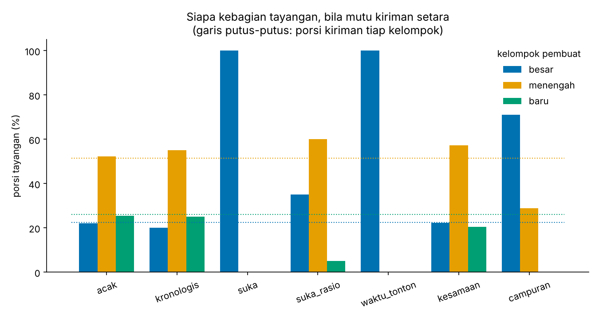
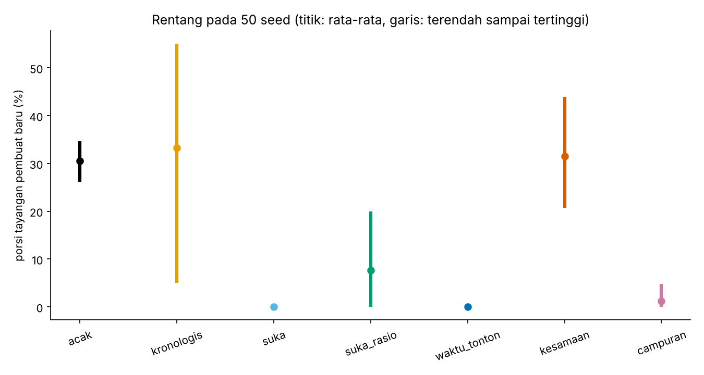
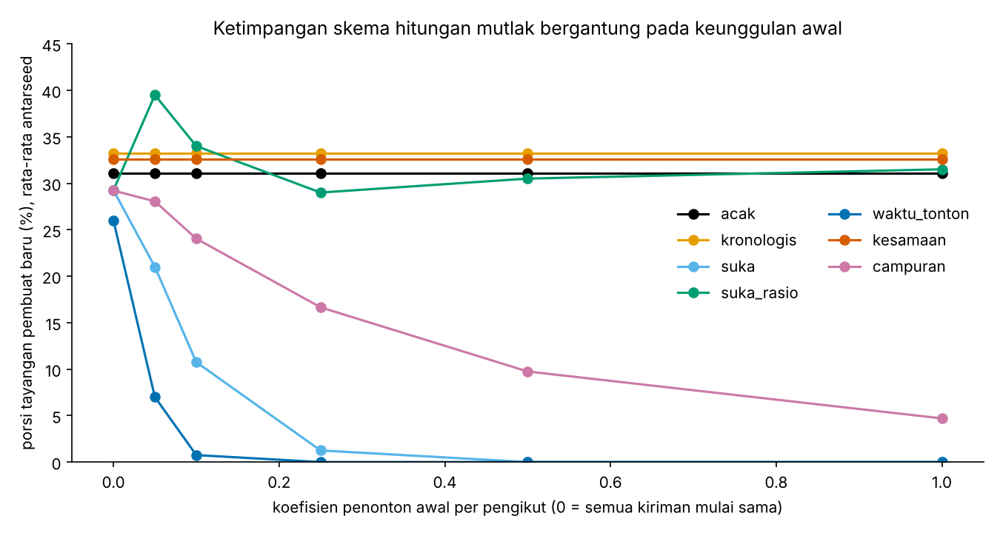
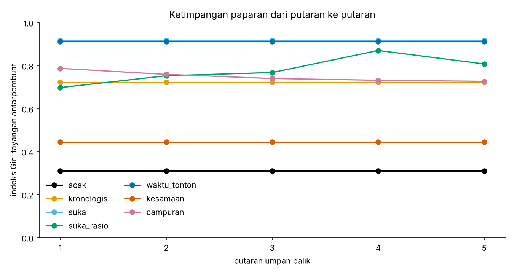

# Cermin Algoritma: siapa yang terlihat ketika umpan memilih bobotnya


> Status: percobaan utama selesai dan sudah diuji ketahanannya terhadap seed dan terhadap asumsi utamanya. Karya ini boleh disempurnakan seiring waktu; batasnya ditulis di bagian Keterbatasan.

## Gagasan

Langdon Winner, dalam esai "Do Artifacts Have Politics?" (*Daedalus*, vol. 109, no. 1, 1980), berpendapat bahwa sebuah artefak teknis dapat mengandung pengaturan kuasa: rancangannya sendiri ikut menentukan siapa diuntungkan dan siapa tersingkir, bukan hanya cara orang memakainya.

Proyek ini menguji gagasan itu pada benda yang lebih dekat dengan keseharian: **rumus pengurut umpan**. Pertanyaannya: bila mutu kiriman dibuat setara antarkelompok pembuat, apakah pilihan bobot (waktu tonton, *like*, kebaruan, kesamaan minat) dengan sendirinya menggeser paparan ke kelompok tertentu? Jawaban yang ditemukan lebih sempit daripada dugaan awal; lihat bagian Hasil.

Bentuknya percobaan yang bisa dijalankan ulang, bukan esai: data fiktif dengan *seed* tetap, beberapa skema bobot, lalu paparan tiap kelompok diukur dengan angka yang sama.

## Kasus fiktif: Warung Kabar

| Unsur | Isi |
|---|---|
| Pengguna | 200, masing-masing punya minat pada 6 topik |
| Pembuat | 40, dalam tiga kelompok: besar (5), menengah (15), baru (20) |
| Kiriman | 1.000, dengan topik, umur, durasi, dan mutu laten |
| Relasi ikut | pembuat besar lebih sering diikuti daripada menengah dan baru |

Contoh ringkasan untuk *seed* 2026:

```text
Warung Kabar (fiktif), seed 2026
  pengguna: 200, pembuat: 40, kiriman: 1000
  besar     pembuat  5, kiriman  224, rerata pengikut  79.8
  menengah  pembuat 15, kiriman  515, rerata pengikut  20.8
  baru      pembuat 20, kiriman  261, rerata pengikut   3.7
```

## Skema umpan yang dibandingkan

Untuk tiap pengguna, umpan berisi 20 kiriman teratas menurut skema. Umpan hanya melihat sinyal, tidak pernah melihat mutu laten.

| Skema | Cara menimbang |
|---|---|
| `acak` | Urutan acak. Pembanding: apa yang terjadi bila umpan tidak memihak. |
| `kronologis` | Yang terbaru lebih dulu. |
| `suka` | Jumlah suka mutlak. |
| `suka_rasio` | Suka per penonton awal (dengan penghalus). |
| `waktu_tonton` | Total detik tonton. |
| `kesamaan` | Kecocokan topik dengan minat pengguna saja. |
| `campuran` | 0,4 kesamaan + 0,3 suka (skala log) + 0,3 kebaruan. |

## Hasil percobaan (seed 2026)

Porsi tayangan per kelompok pembuat. Sebagai patokan, porsi kiriman: besar 22,4%, menengah 51,5%, baru 26,1%.

| Skema | Besar | Menengah | Baru | Gini antarpembuat | Pembuat tanpa tayangan (dari 40) |
|---|---:|---:|---:|---:|---:|
| acak | 22,2% | 52,3% | 25,5% | 0,31 | 0 |
| kronologis | 20,0% | 55,0% | 25,0% | 0,72 | 26 |
| suka | 100,0% | 0,0% | 0,0% | 0,92 | 35 |
| suka_rasio | 35,0% | 60,0% | 5,0% | 0,70 | 25 |
| waktu_tonton | 100,0% | 0,0% | 0,0% | 0,91 | 35 |
| kesamaan | 22,2% | 57,4% | 20,4% | 0,45 | 6 |
| campuran | 71,1% | 28,9% | 0,0% | 0,79 | 21 |



Satu seed adalah satu undian. Dua bagian berikut memeriksa seberapa jauh tabel ini dapat dipegang.

### Pada 50 seed

Konfigurasi sama, seed 1 sampai 50. Angka mentah ada di [`docs/kepekaan.json`](docs/kepekaan.json).

| Skema | Porsi tayangan pembuat baru, rata-rata (terendah sampai tertinggi) | Gini rata-rata (terendah sampai tertinggi) |
|---|---:|---:|
| acak | 30,5% (26 sampai 35) | 0,27 (0,23 sampai 0,32) |
| kronologis | 33,3% (5 sampai 55) | 0,68 (0,50 sampai 0,81) |
| suka | 0,0% (0 sampai 0) | 0,91 (0,89 sampai 0,93) |
| suka_rasio | 7,6% (0 sampai 20) | 0,75 (0,69 sampai 0,84) |
| waktu_tonton | 0,0% (0 sampai 0) | 0,91 (0,89 sampai 0,94) |
| kesamaan | 31,6% (21 sampai 44) | 0,39 (0,29 sampai 0,51) |
| campuran | 1,2% (0 sampai 5) | 0,80 (0,74 sampai 0,85) |



Pada konfigurasi ini, `suka` dan `waktu_tonton` memberi pembuat baru nol tayangan pada **semua** 50 seed. `kronologis` sangat bervariasi (5% sampai 55%) karena hasilnya hanya bergantung pada kebetulan kiriman mana yang paling baru; satu seed tidak boleh dibaca sebagai sifatnya.

### Apakah hasilnya hanya buah asumsi? (sapuan koefisien)

Dalam konfigurasi utama, penonton awal sebuah kiriman = 1 + 0,5 x jumlah pengikut pembuatnya. Itu asumsi saya. Untuk mengujinya, koefisien 0,5 divariasikan dari 0 (semua kiriman mulai dengan penonton yang sama) sampai 1,0, dengan penonton dasar 20 supaya sinyal tetap berarti pada koefisien 0. Rata-rata 20 seed:

| Porsi tayangan pembuat baru | koef 0 | 0,05 | 0,1 | 0,25 | 0,5 | 1,0 |
|---|---:|---:|---:|---:|---:|---:|
| acak | 31,1% | 31,1% | 31,1% | 31,1% | 31,1% | 31,1% |
| kronologis | 33,2% | 33,2% | 33,2% | 33,2% | 33,2% | 33,2% |
| suka | 29,2% | 21,0% | 10,8% | 1,2% | 0,0% | 0,0% |
| suka_rasio | 29,2% | 39,5% | 34,0% | 29,0% | 30,5% | 31,5% |
| waktu_tonton | 26,0% | 7,0% | 0,8% | 0,0% | 0,0% | 0,0% |
| kesamaan | 32,6% | 32,6% | 32,6% | 32,6% | 32,6% | 32,6% |
| campuran | 29,2% | 28,0% | 24,0% | 16,7% | 9,7% | 4,7% |



### Apa yang dapat dikatakan, dan apa yang tidak

- **Bobot saja tidak cukup untuk menyingkirkan pembuat baru.** Bila semua kiriman mulai dengan penonton yang sama (koefisien 0), `suka` memberi pembuat baru 29,2%, hampir sama dengan umpan acak (31,1%). Dugaan awal proyek ini, bahwa pilihan rumus sendirian menggeser paparan, **tidak didukung**.
- **Yang didukung adalah yang lebih sempit:** rumus berbasis hitungan mutlak (`suka`, `waktu_tonton`, dan `campuran` sebagian) *meneruskan* keunggulan audiens awal. Makin besar keunggulan itu, makin habis pembuat baru: pada `suka`, dari 29,2% (koefisien 0) ke 0,0% (koefisien 0,5 ke atas). Rumus berbasis rasio (`suka_rasio`) dan minat (`kesamaan`) tetap di kisaran 29% sampai 40% berapa pun keunggulan awalnya.
- Ini sejalan dengan gagasan Winner yang lebih hati-hati: artefak tidak menciptakan kuasa dari nol, tetapi memasangnya menjadi tatanan yang bertahan. Percobaan ini tidak membuktikan tesis Winner; ia memperlihatkan satu mekanisme tempat tatanan itu dapat terpasang.
- `suka_rasio` pada konfigurasi utama (7,6%) lebih rendah daripada pada sapuan (29% sampai 40%). Dugaan saya, penghalus `(suka + 1) / (penonton + 10)` menarik kiriman berpenonton sedikit ke bawah rata-rata. Ini dugaan; belum diuji terpisah.
- Seberapa besar keunggulan awal di platform nyata tidak diketahui dari percobaan ini. Koefisien 0,5 hanya satu titik di sapuan, bukan taksiran.

### Bila posisi ikut ditimbang

Bobot posisi `1 / log2(posisi + 1)` (kiriman paling atas bernilai 1) mengubah angka namun tidak mengubah arah untuk skema yang timpang. Pada seed 2026, porsi tayangan berbobot pembuat baru: `suka` 0,0%, `waktu_tonton` 0,0%, `campuran` 0,0%, tetapi `suka_rasio` naik dari 5,0% menjadi 14,2% dan `kronologis` turun dari 25,0% menjadi 22,4%. Jadi angka kelompok bergeser cukup besar untuk skema yang berada di tengah. Bobot ini pendekatan saya, bukan data perilaku nyata.

## Bila umpan balik diulang

Satu putaran hanya memotret. Di platform, tayangan menghasilkan suka, dan suka menentukan tayangan berikutnya. `jalankan_berulang` meniru itu selama lima putaran: tiap tayangan menambah penonton, dan dengan peluang yang hanya bergantung pada mutu laten menambah suka dan waktu tonton, lalu umpan disusun ulang.



Yang terlihat, dengan batasnya:

- Skema yang tidak memakai sinyal keterlibatan (`acak`, `kronologis`, `kesamaan`) tidak berubah sama sekali antarputaran. Garisnya datar karena memang tidak ada yang diumpankan kembali.
- `suka` dan `waktu_tonton` sudah memberi semua tayangan kepada kiriman yang sama sejak putaran pertama, jadi umpan balik tidak mengubah apa pun. Kiriman yang tidak pernah tampil tidak pernah mendapat kesempatan membuktikan mutunya. (Kedua garis hampir berimpit di grafik.)
- `suka_rasio` bergerak tidak beraturan (Gini 0,70 sampai 0,87) dan `campuran` perlahan turun (0,79 ke 0,73). Dengan satu dataset dan satu seed untuk umpan balik, saya **tidak** menyimpulkan arah umum dari gerakan ini.
- Jadi percobaan ini tidak memperlihatkan "orang kaya makin kaya" secara dinamis. Ketimpangan di sini sudah ada pada putaran pertama karena asumsi sinyal awal; yang diperlihatkan umpan balik hanyalah bahwa ia tidak memperbaikinya.

## Keputusan desain

| Keputusan | Alasan |
|---|---|
| Mutu laten diambil dari sebaran yang sama, Beta(2, 2), untuk semua kelompok | Bila paparan nanti timpang, sebabnya dapat dilacak ke bobot umpan, bukan ke perbedaan mutu. |
| Mutu laten tidak terlihat oleh umpan | Platform nyata juga hanya melihat sinyal (tonton, *like*), bukan mutu itu sendiri. |
| Pembuat besar lebih banyak diikuti dan lebih aktif | Ketimpangan awal ini sengaja dibuat, supaya terlihat apakah sebuah skema memperbesar atau meredamnya. |
| *Seed* tetap dan hanya pustaka standar `random` | Siapa pun dapat menjalankan ulang dan mendapat angka yang sama. |
| Penonton awal sebanding dengan pengikut, suka bergantung pada mutu | Mewakili dua hal yang masuk akal: kiriman bermutu lebih disukai, dan pembuat berpengikut banyak lebih dulu dilihat. Asumsi ini menentukan hasil dan ditulis terang. |
| Ada skema `acak` sebagai pembanding | Tanpa patokan "tidak memihak", angka tiap skema sulit ditafsirkan. |
| Dua versi skema suka: mutlak dan per penonton | Memperlihatkan bahwa satu keputusan kecil dalam rumus mengubah siapa yang tampil. |
| Metrik: porsi tayangan per kelompok dan Gini antarpembuat | Porsi mudah dibaca; Gini menangkap ketimpangan di dalam kelompok juga. |
| Sapuan koefisien penonton awal dan 50 seed, angka mentah disimpan di `docs/kepekaan.json` | Asumsi yang menentukan hasil harus diuji, dan klaim harus dapat diperiksa tanpa menjalankan ulang lima menit. |
| Metrik tayangan berbobot posisi sebagai pelengkap | Tayangan di posisi atas tidak setara dengan yang di bawah; bobotnya pendekatan, bukan data. |
| Data seluruhnya fiktif | Tidak ada data pribadi, dan tidak ada klaim tentang platform tertentu. |

## Keterbatasan

- Data fiktif hanya memperlihatkan **mekanisme**. Hasilnya tidak membuktikan bagaimana platform nyata berperilaku.
- Angka-angka dasar (jumlah pembuat, peluang diikuti, bobot keaktifan) adalah pilihan penyusun, bukan hasil pengukuran. Mengubahnya dapat mengubah hasil.
- Umpan balik hanya lima putaran dan satu deret angka acak. Pengguna, kiriman, dan pengikut tetap; pembuat tidak belajar, berhenti, atau menyesuaikan diri.
- Pengguna melihat 20 kiriman; bobot posisi hanya dipakai sebagai metrik pelengkap, bukan dalam perilaku pengguna di simulasi.
- Sinyal awal adalah buatan model, bukan perilaku pengguna sungguhan; angka ambang (mis. 0,3 peluang suka) dipilih penyusun.
- Hasil pada satu seed bisa berbeda; hanya temuan yang diuji pada beberapa seed yang diklaim di atas.

## Menjalankan

```bash
pip install -r requirements.txt
pip install -e .
python -m pytest
python -m cermin.data       # ringkasan data fiktif
python -m cermin.simulasi   # tabel perbandingan skema
python -m cermin.kepekaan   # 50 seed dan sapuan koefisien (sekitar 5 menit), menulis docs/kepekaan.json
python -m cermin.grafik     # menulis ulang grafik di docs/
```

60 uji otomatis mencakup generator data (determinisme, sebaran, relasi), metrik (Gini dengan hitungan tangan dan kasus batas), skema umpan, umpan balik berulang, uji kepekaan, pembuatan grafik, dan temuan utama pada beberapa seed.

## Transparansi bantuan AI

Rancangan, kode, dan pengujian disusun dengan bantuan AI (Claude). Pilihan kasus, keputusan desain, dan peninjauan dilakukan oleh saya.

## Lisensi

All rights reserved. Kode ini dapat dibaca dan dipelajari, tetapi tidak boleh disalin atau dipakai ulang tanpa izin tertulis. Lihat [LICENSE](LICENSE).
